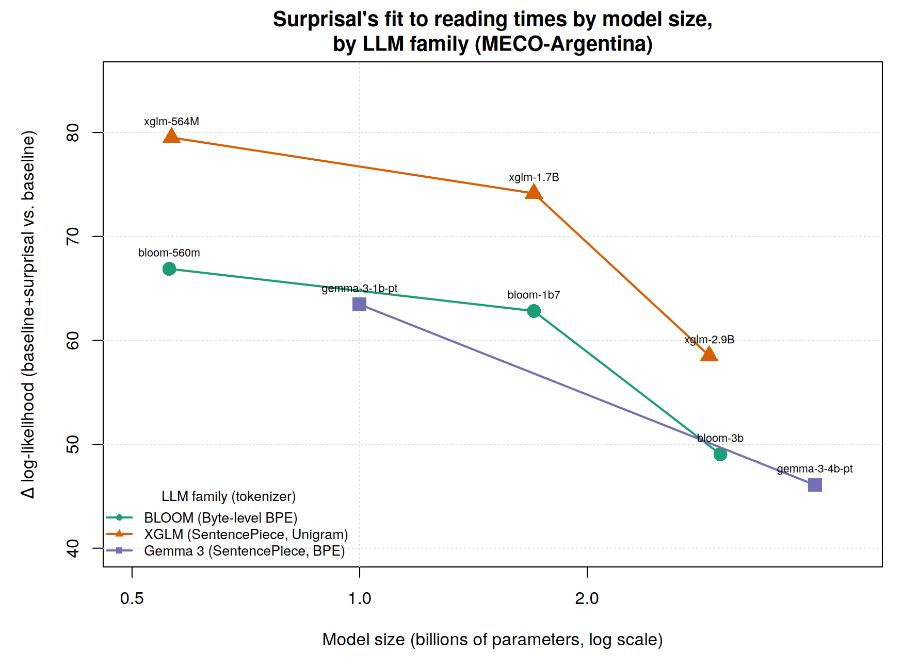

# Do larger multilingual LLMs predict Rioplatense Spanish reading better?

**Surprisal, model size and reading times in MECO-Argentina**

Term paper for the course *Theories of Sentence Processing* (Universität Potsdam) · Eloy Rossen

---

## Research question

Language models make it possible to estimate the **surprisal** of each word (−log₂ P(word | context)), a classic predictor of reading difficulty: the less expected a word is, the longer readers look at it. Recent work on English (Oh & Schuler, 2023) found a counterintuitive result, known as *inverse scaling*: as models grow larger, their surprisal predicts human reading times **worse**.

This project asks whether that pattern also holds for a Spanish variety that is far less represented in training data. To avoid confounding size with architecture or training data, models are compared **within each model family**.

## Data

- **MECO, Wave 1, Argentinian subsample** (Siegelman et al., 2022): eye-tracking during natural reading of 12 encyclopaedic texts, **48 Rioplatense participants**, 2,411 stimulus words, 87,275 participant × word observations. File `joint_l1_data_trimmed_version2.1.rda` (filtered to `lang == "sp"`), available on [OSF](https://osf.io/3527a/). It is not redistributed in this repository.
- **EsPal** (Duchon et al., 2013), *Written and Web Tokens* corpus: length and log frequency of each word (99.7% coverage; the only missing items are numbers and a dash).

## Models

Eight checkpoints from three multilingual families, all run locally with the [`llm_surprisal`](https://github.com/tmalsburg/llm_surprisal) tool (von der Malsburg, 2026):

| Family | Tokenizer | Checkpoints |
|---|---|---|
| BLOOM | Byte-level BPE | `bloom-560m`, `bloom-1b7`, `bloom-3b` |
| XGLM | SentencePiece (unigram) | `xglm-564M`, `xglm-1.7B`, `xglm-2.9B` |
| Gemma 3 | SentencePiece (BPE) | `gemma-3-1b-pt`, `gemma-3-4b-pt` |

Within BLOOM and within XGLM it was verified empirically that all three sizes tokenize the text identically, so differences between sizes cannot be attributed to subword segmentation.

## What was done

1. **Stimulus reconstruction.** MECO has one row per word; sentences were rebuilt by grouping on `trialid` + `sentnum` and ordering by `wordnum`. The text was taken from all participants rather than a single one, because the *trimmed* file does not have full coverage per participant (only 11 of the 48 read all 12 texts).
2. **Surprisal computation.** For each sentence, `llm_generate.py` returns per-token surprisal; in R, subword surprisals are summed to obtain each word's surprisal (`Scurr`) and that of the previous word (`Sprev`). A *batched* version (`BatchedSurprisal.R`) was written that loads each model once instead of once per sentence: it is ~2.7× faster and numerically identical to the course's original function (maximum difference 5 × 10⁻¹⁴).
3. **Baseline predictors.** Length and frequency of the current and previous word (`Lcurr`, `Fcurr`, `Lprev`, `Fprev`), from EsPal.
4. **Exclusions.** Skipped words, words with first-pass duration outside (0, 5000) ms, and the first and last word of each sentence. **53,464** observations remain.
5. **Mixed-effects models.** Dependent variable: `log(firstrun.dur)` (first-pass reading time). Baseline: `Lcurr + Lprev + Fcurr + Fprev + (1|participant) + (1|text)`. For each LLM, `Scurr + Sprev` are added and the model is compared against the baseline with a likelihood-ratio test. The measure of interest is the **Δ log-likelihood**: how much the fit improves when that model's surprisal is added.
6. **Extension** to five other eye-tracking measures (`nfix`, `firstfix.dur`, `dur`, `reg.in`, `reg.out`).

## Results

Surprisal from all eight models significantly improves the fit (all p < 10⁻²⁰), with the expected sign: higher surprisal, slower reading. But within each family, **the larger the model, the less it explains**:

| Family | Size → Δ log-likelihood |
|---|---|
| BLOOM | 0.56B: **66.9** → 1.7B: **62.8** → 3B: **49.0** |
| XGLM | 0.56B: **79.5** → 1.7B: **74.1** → 2.9B: **58.5** |
| Gemma 3 | 1B: **63.5** → 4B: **46.1** |



The decline is monotonic in all three families, without exception: the inverse scaling reported for English also appears in Rioplatense Spanish. Further findings:

- At comparable size, **XGLM** predicts better than BLOOM and Gemma 3 at all three size levels ([figure](figures/size_bin_comparison_EN.png)).
- The pattern replicates for `nfix`, `dur` and `reg.in`. By contrast, **`firstfix.dur` shows no surprisal effect** for any of the eight models, consistent with the view that the first fixation indexes earlier processes than lexical integration. `reg.out` shows a weak pattern that is inconsistent across families ([figure](figures/et_measures_comparison_EN.png)).

## Limitations

- **Few data points per family** (2–3): the evidence is consistent with Oh & Schuler (2023), but it cannot rule out explanations unrelated to size itself.
- **Tokenizer and family coincide**: each family uses a single tokenization algorithm, so the design cannot separate the effect of architecture from that of the tokenizer in comparisons *across* families.
- **Context resets at each sentence**: the model does not see the preceding sentences of the text, unlike the human reader.
- **Non-Rioplatense frequencies**: EsPal has no dialect filter. The two sources with a genuine Rioplatense filter (CORPES XXI and PRESEEA) do not allow bulk queries.
- `gemma-3-4b-pt` is a multimodal checkpoint evaluated on text only.
- `nfix` was modelled with `lmer` on the log of the count, as an approximation to a count GLMM.

## Repository structure

```
├── README.md                    this file
├── CODE.md                      step-by-step guide to reproduce the analysis
├── llm_surprisal/               von der Malsburg's tool (GPL-3), with a fix for gemma-3-4b-pt
├── scripts/
│   ├── TermPaperHelperFunctions.R   course helper functions (unmodified)
│   ├── BatchedSurprisal.R           own batched version of add_surprisals()
│   ├── compute_chunk.R              computes one model's surprisal for a set of texts
│   ├── fit_models.R                 baseline vs. baseline + surprisal (LRT) for the 8 models
│   └── plot_scaling.R               scaling plot by family
├── data/master_with_baseline.csv    2,411 words with length and frequency (EsPal)
├── surprisal_cache/                 per-word surprisal from each of the 8 models
├── results/                         model comparison tables
└── figures/                         plots
```

## Main references

- Duchon, A., Perea, M., Sebastián-Gallés, N., Martí, A., & Carreiras, M. (2013). EsPal: One-stop shopping for Spanish word properties. *Behavior Research Methods, 45*(4), 1246–1258.
- Oh, B.-D., & Schuler, W. (2023). Why does surprisal from larger transformer-based language models provide a poorer fit to human reading times? *Transactions of the ACL, 11*, 336–350.
- Siegelman, N., et al. (2022). Expanding horizons of cross-linguistic research on reading: The Multilingual Eye-movement Corpus (MECO). *Behavior Research Methods, 54*, 2843–2863.
- von der Malsburg, T. (2026). *llm_surprisal: Command-line tools for low-barrier reproducible experiments with transformer models.* https://github.com/tmalsburg/llm_surprisal

## License

The `llm_surprisal/` directory is distributed under the GNU GPL v3 (see `llm_surprisal/LICENSE`). Change from the original: in `models.py`, `gemma-3-4b-pt` is loaded with `Gemma3ForConditionalGeneration` instead of `Gemma3ForCausalLM` (November 2026; see `CODE.md`).
